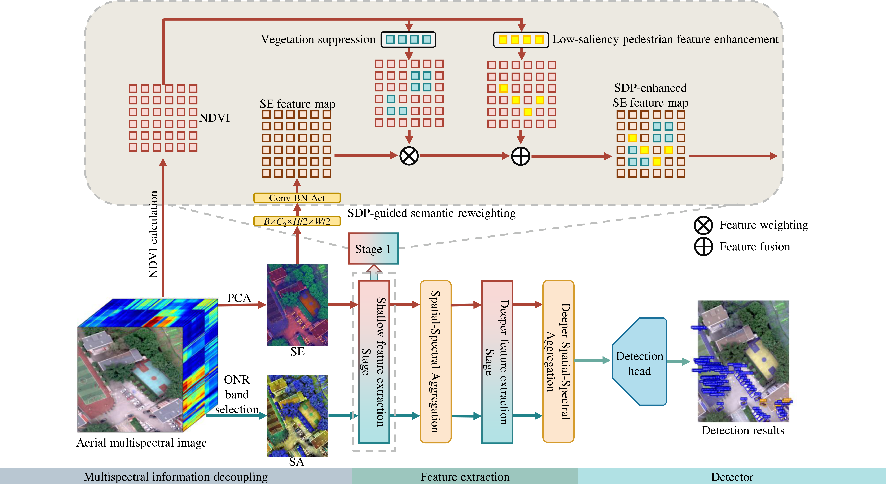
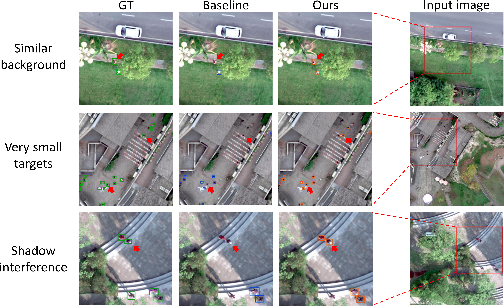
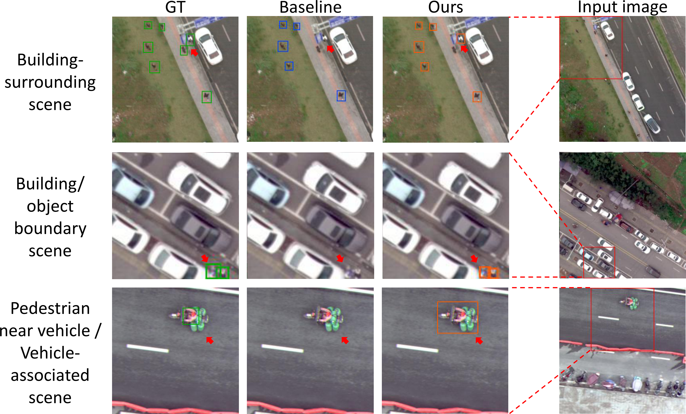

# S2ADet-SDP

PyTorch implementation for **Spectral-Prior-Guided Feature Enhancement for Pedestrian Detection in Aerial Multispectral Images**.

S2ADet-SDP extends the dual-stream S2ADet framework with spectral-difference-prior guided feature enhancement for pedestrian detection in aerial multispectral images. The method uses auxiliary semantic maps, such as NDVI-derived cues, to enhance shallow features and suppress vegetation-related false detections.

## Main Features

- Dual-stream object detection for aerial multispectral images.
- SDP-guided semantic reweighting for shallow feature enhancement.
- Multiscale top-hat based enhancement for low-saliency pedestrian responses.
- Training, evaluation, inference, and MODA preprocessing utilities.

## Schematic diagram of model structure

<div>
    
</div>

## model performance

<div>
    
</div>
<div>
    
</div>

## Installation

Python 3.8 or later is recommended. Install the required packages with:

```bash
pip install -r requirements.txt
```

The code is based on YOLOv5-style training and evaluation. Please install a PyTorch version compatible with your CUDA environment.

> `requirements.txt` only contains the dependencies required for model training, and mmengine is also needed for the operation of `feature_utils/`.

## Dataset Preparation

This repository does not include the MODA dataset. Please download MODA from the official repository:

- MODA: https://github.com/shuaihao-han/MODA

After preprocessing, organize the data paths used by the YAML configuration files. A typical structure is:

```text
datasets/
  MODAfeature/
    sa/images/train/
    sa/images/val/
    se/images/train/
    se/images/val/
    NDVI/images/train/
    NDVI/images/val/
    sobel/images/train/
    sobel/images/val/
```

Update the paths in `data/hsi/*.yaml` before training or testing. The keys used by the dataloader include:

```yaml
train_rgb: path/to/sa/images/train/
train_rgb_add: path/to/sobel/images/train/
val_rgb: path/to/sa/images/val/
val_rgb_add: path/to/sobel/images/val/
train_ir: path/to/se/images/train/
train_ir_add: path/to/NDVI/images/train/
val_ir: path/to/se/images/val/
val_ir_add: path/to/NDVI/images/val/
```

Preprocessing scripts are provided in `feature_utils/`:

- `feature_generation.py`: generate NDVI and Sobel feature maps.
- `rgb_generation.py`: generate RGB images for visualization.
- `mmlab/dota_split.py`: sliding-window splitting utility.
- `Rotate box to horizontal box.py`: convert rotated boxes to horizontal boxes.
- `High difficulty label division/`: create the challenging pedestrian subset.

> It is worth mentioning that the Sobel channel is currently unused and only occupies a place. Neither the SDP module nor other modules will process it.

## Training

Place the initial YOLOv5 weights in `yolo_weight/` or pass a custom path with `--weights`.

```bash
python train.py --data data/hsi/hsi_twostream_test.yaml --cfg models/hsi/yolov5l_fusion_transformerx3_hsi_semantic.yaml --weights yolo_weight/yolov5l.pt --img-size 640 640 --batch-size 8 --epochs 50 --device 0
```

Training outputs are saved under `runsx3/train/` by default.

## Evaluation

Evaluate a trained checkpoint with:

```bash
python test.py --data data/hsi/hsi_twostream_test.yaml --weights path/to/best.pt --batch-size 16 --img-size 640 --device 0
```

For the challenging pedestrian subset, prepare a separate YAML file with the same fields and point it to the subset image directories.

## Inference

Run inference on paired multispectral streams:

```bash
python detect_twostream.py --weights path/to/best.pt --source1 path/to/sa/images/test/ --source2 path/to/se/images/test/ --source1-add path/to/sobel/images/test/ --source2-add path/to/NDVI/images/test/ --img-size 640 --conf-thres 0.4 --iou-thres 0.45 --device 0
```

`source1`, `source2`, `source1-add`, and `source2-add` should correspond to the two streams expected by the trained model and data configuration.

## Weights

Large model weights are not stored directly in this repository. Pretrained or trained weights can be provided through a release page, external repository, or on request. After downloading, pass the checkpoint path using `--weights`.

## Results

On the MODA test set, S2ADet-SDP improves pedestrian precision and AP over the S2ADet baseline, especially for small and low-saliency pedestrian targets in complex aerial scenes. Detailed results are reported in the associated paper.

## Citation

If this repository is useful for your research, please cite the paper. The BibTeX entry will be updated after publication.

```bibtex
Coming soon
```

## Acknowledgments

This project builds on S2ADet:

- S2ADet: https://github.com/hexiao0275/S2ADet

We thank the authors of these projects for making their code publicly available.

## License

This repository follows the license provided in `LICENSE`. Please also check the licenses of YOLOv5, S2ADet, MODA, and any pretrained weights or datasets used with this code.
